# Projects / Visual Catalog — 全47件

**全件版 · 2026-11-27 · 公開カタログ**

全47件（公開14件・非公開33件）。GitHub APIの `updated_at` を取得し、降順で表示（JST）。掲載先の tr-o/tr-o も1件に含む。日時は取得時のスナップショット。

各プロジェクトに3枠、合計141枠。公開元画像 7 枚、非公開元図へのリンクカード 38 枚、概念・メタデータ図 96 枚。非公開リポジトリ名・リンクは公開されていますが、元画像や研究データはこのカタログにコピーしていません。非公開ファイルの閲覧には元リポジトリの権限が必要です。非公開の概要は名称に基づく一般的な説明に限定しています。概念図は実測・計算成果ではありません。元画像候補はファイル名と保存先による選定で、画像内容の個別目視確認は未実施です。元図が未確認の場合は概念図を使用しています。既存の公開3プロジェクトの図を維持しました。

| Project | Visibility | Updated (JST) | Focus |
|---|---|---|---|
| [stirring-sim](#repo-stirring-sim) | private | 2026-11-22 | 撹拌流体シミュレーション関連 |
| [dlvo](#repo-dlvo) | public | 2026-11-15 | DLVO相互作用計算 |
| [th-dyna](#repo-th-dyna) | private | 2026-11-14 | 熱力学関連 |
| [particle](#repo-particle) | private | 2026-11-14 | 粒子シミュレーション関連 |
| [nanolaser-np-research](#repo-nanolaser-np-research) | private | 2026-11-12 | レーザーとナノ粒子関連 |
| [tem-nanoparticle-analyzer](#repo-tem-nanoparticle-analyzer) | public | 2026-10-30 | TEMナノ粒子画像解析 |
| [dft-flow](#repo-dft-flow) | private | 2026-10-28 | DFT計算関連 |
| [mlp-flow](#repo-mlp-flow) | private | 2026-10-27 | 機械学習ポテンシャル関連 |
| [qchem-local](#repo-qchem-local) | private | 2026-10-27 | ローカル量子化学計算関連 |
| [alexa-shopping-memo-skill-example](#repo-alexa-shopping-memo-skill-example) | public | 2026-10-27 | Alexa買い物メモスキルの例 |
| [oxidation-descriptors](#repo-oxidation-descriptors) | private | 2026-10-26 | 酸化特性記述子関連 |
| [medic](#repo-medic) | private | 2026-10-26 | 非公開プロジェクト |
| [lir-fw-kinetics-report](#repo-lir-fw-kinetics-report) | private | 2026-10-22 | 反応速度解析関連 |
| [sim-beam](#repo-sim-beam) | private | 2026-10-21 | レーザーシミュレーション関連 |
| [piezo](#repo-piezo) | private | 2026-10-20 | 圧電材料関連 |
| [public-data-warp](#repo-public-data-warp) | private | 2026-10-20 | 公開データ解析関連 |
| [harry-potter-shadowing](#repo-harry-potter-shadowing) | private | 2026-10-20 | 英語学習関連 |
| [orca](#repo-orca) | private | 2026-10-07 | 量子化学計算関連 |
| [python-document-processor-for-mom](#repo-python-document-processor-for-mom) | private | 2026-09-21 | 文書処理関連 |
| [meltingpoint-prediction](#repo-meltingpoint-prediction) | private | 2026-09-14 | 融点予測関連 |
| [cpa2021v02](#repo-cpa2021v02) | private | 2026-04-06 | 非公開プロジェクト |
| [GAS-Dynamic-Data-Visualizer](#repo-gas-dynamic-data-visualizer) | public | 2026-03-29 | Google Apps Scriptによる動的データ可視化 |
| [google-sheets-data-visualization](#repo-google-sheets-data-visualization) | public | 2026-03-29 | Google Sheetsのデータ可視化 |
| [SwitchBot-Data-Logger-for-Google-Sheets](#repo-switchbot-data-logger-for-google-sheets) | public | 2026-02-06 | SwitchBotデータのGoogle Sheets記録 |
| [tes-repo](#repo-tes-repo) | private | 2026-01-06 | テスト用リポジトリ |
| [coten](#repo-coten) | private | 2025-12-11 | 非公開プロジェクト |
| [mic-fft](#repo-mic-fft) | private | 2025-12-11 | マイク入力とFFT |
| [experiment-django](#repo-experiment-django) | private | 2025-11-27 | Djangoによる実験関連開発 |
| [django-demo](#repo-django-demo) | private | 2025-11-22 | Djangoのデモ |
| [experiment-master](#repo-experiment-master) | private | 2025-11-20 | 実験管理関連 |
| [mixtracer_c](#repo-mixtracer_c) | private | 2025-11-17 | C言語関連プロジェクト |
| [gomi-notify-discord](#repo-gomi-notify-discord) | private | 2025-11-16 | Discord通知関連 |
| [train-passing-timetable](#repo-train-passing-timetable) | private | 2025-11-03 | 鉄道時刻表関連 |
| [photoserver](#repo-photoserver) | private | 2025-09-28 | 写真サーバー |
| [speech-fluency-coach](#repo-speech-fluency-coach) | private | 2025-07-20 | 発話練習関連 |
| [train-go-through](#repo-train-go-through) | public | 2025-06-01 | 鉄道関連プロジェクト |
| [SwitchBot-ESP32-GoogleSheet-Logger](#repo-switchbot-esp32-googlesheet-logger) | public | 2025-03-13 | ESP32とSwitchBotによるデータ記録 |
| [Python-SwitchBot-API-Example](#repo-python-switchbot-api-example) | public | 2024-02-23 | PythonによるSwitchBot APIの利用例 |
| [python-image-process-exercise](#repo-python-image-process-exercise) | public | 2023-07-08 | Python画像処理の演習 |
| [image-process-exercise](#repo-image-process-exercise) | private | 2023-05-11 | 画像処理の演習 |
| [Mermaid-syntax-for-chemical-process](#repo-mermaid-syntax-for-chemical-process) | private | 2023-05-05 | 化学プロセス図のMermaid記法 |
| [Mermaid-syntax-for-chemicaal-process](#repo-mermaid-syntax-for-chemicaal-process) | private | 2023-05-05 | 化学プロセス図の記法（別リポジトリ） |
| [Summar-of-aluminum-production](#repo-summar-of-aluminum-production) | private | 2023-05-05 | アルミニウム製造の整理 |
| [Tempo-control-Arduino-MIDI-Drum-Sequencer](#repo-tempo-control-arduino-midi-drum-sequencer) | public | 2023-05-04 | Arduino MIDIドラムシーケンサー |
| [LINE-spreadsheeet-aidedGarbageReminder](#repo-line-spreadsheeet-aidedgarbagereminder) | public | 2023-05-01 | スプレッドシートを利用したゴミ出し通知 |
| [test](#repo-test) | public | 2022-01-23 | テスト用リポジトリ |
| [tr-o](#repo-tr-o) | public | 2022-01-23 | 全リポジトリのビジュアルカタログ |

## stirring-sim

撹拌流体シミュレーション関連。詳細・成果はアクセス権のあるユーザーのみリンク先で確認できます。

[Repository ↗](https://github.com/tr-o/stirring-sim) · private · Updated: 2026-11-22 JST

<table><tr>
<td width="33%" align="center"> 元図 1（権限が必要）</td>
<td width="33%" align="center"> 元図 2（権限が必要）</td>
<td width="33%" align="center"> 元図 3（権限が必要）</td>
</tr></table>

非公開の画像は公開側に複製していません。鍵付きカードは元ファイルへのリンクです。

## dlvo

コロイド粒子間のファンデルワールス引力・電気二重層反発を計算。非線形PB、球曲率、電荷調節、吸着層の条件探索。

[Repository ↗](https://github.com/tr-o/dlvo) · Updated: 2026-11-15 JST

<table><tr>
<td width="33%" align="center"> DLVO相互作用</td>
<td width="33%" align="center"> 10 nm粒子の電位分布</td>
<td width="33%" align="center"> 安定化に必要な吸着層反発</td>
</tr></table>

図：元リポジトリの保存済み成果（コミット固定リンク）。

## th-dyna

熱力学関連。詳細・成果はアクセス権のあるユーザーのみリンク先で確認できます。

[Repository ↗](https://github.com/tr-o/th-dyna) · private · Updated: 2026-11-14 JST

<table><tr>
<td width="33%" align="center"> 元図 1（権限が必要）</td>
<td width="33%" align="center"> 元図 2（権限が必要）</td>
<td width="33%" align="center"> リポジトリ情報（概念図）</td>
</tr></table>

非公開の画像は公開側に複製していません。鍵付きカードは元ファイルへのリンクです。

## particle

粒子シミュレーション関連。詳細・成果はアクセス権のあるユーザーのみリンク先で確認できます。

[Repository ↗](https://github.com/tr-o/particle) · private · Updated: 2026-11-14 JST

<table><tr>
<td width="33%" align="center"><a href="https://github.com/tr-o/particle/blob/main/cases/case01/results/generalization/depth_generalization.png">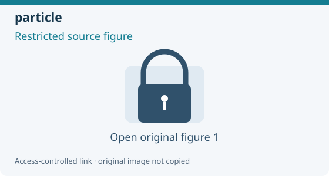</a> 元図 1（権限が必要）</td>
<td width="33%" align="center"> 元図 2（権限が必要）</td>
<td width="33%" align="center"> 元図 3（権限が必要）</td>
</tr></table>

非公開の画像は公開側に複製していません。鍵付きカードは元ファイルへのリンクです。

## nanolaser-np-research

レーザーとナノ粒子関連。詳細・成果はアクセス権のあるユーザーのみリンク先で確認できます。

[Repository ↗](https://github.com/tr-o/nanolaser-np-research) · private · Updated: 2026-11-12 JST

<table><tr>
<td width="33%" align="center"> 元図 1（権限が必要）</td>
<td width="33%" align="center"><a href="https://github.com/tr-o/nanolaser-np-research/blob/main/apps/nanolaser_explorer/figures/arefev_20nm_liquid_fraction.svg">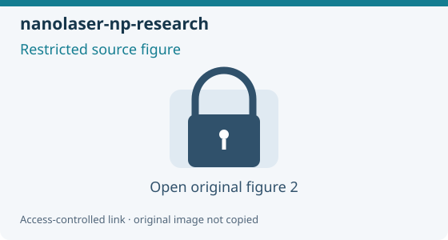</a> 元図 2（権限が必要）</td>
<td width="33%" align="center"> 元図 3（権限が必要）</td>
</tr></table>

非公開の画像は公開側に複製していません。鍵付きカードは元ファイルへのリンクです。

## tem-nanoparticle-analyzer

TEM・HRTEMの粒径計測、粒子分離、スケール校正、監査と教師ありモデルの検証。研究プロトタイプ。

[Repository ↗](https://github.com/tr-o/tem-nanoparticle-analyzer) · Updated: 2026-10-30 JST

<table><tr>
<td width="33%" align="center"> Pt/Ag 6視野の検出監査</td>
<td width="33%" align="center"> DM3/HRTEM解析と粒径分布</td>
<td width="33%" align="center"> 学習データ増量とF1の不確実性</td>
</tr></table>

図：元リポジトリの保存済み成果（コミット固定リンク）。

## dft-flow

DFT計算関連。詳細・成果はアクセス権のあるユーザーのみリンク先で確認できます。

[Repository ↗](https://github.com/tr-o/dft-flow) · private · Updated: 2026-10-28 JST

<table><tr>
<td width="33%" align="center"> 元図 1（権限が必要）</td>
<td width="33%" align="center"> 元図 2（権限が必要）</td>
<td width="33%" align="center"> 元図 3（権限が必要）</td>
</tr></table>

非公開の画像は公開側に複製していません。鍵付きカードは元ファイルへのリンクです。

## mlp-flow

機械学習ポテンシャル関連。詳細・成果はアクセス権のあるユーザーのみリンク先で確認できます。

[Repository ↗](https://github.com/tr-o/mlp-flow) · private · Updated: 2026-10-27 JST

<table><tr>
<td width="33%" align="center"> 元図 1（権限が必要）</td>
<td width="33%" align="center"> 元図 2（権限が必要）</td>
<td width="33%" align="center"> 元図 3（権限が必要）</td>
</tr></table>

非公開の画像は公開側に複製していません。鍵付きカードは元ファイルへのリンクです。

## qchem-local

ローカル量子化学計算関連。詳細・成果はアクセス権のあるユーザーのみリンク先で確認できます。

[Repository ↗](https://github.com/tr-o/qchem-local) · private · Updated: 2026-10-27 JST

<table><tr>
<td width="33%" align="center"><a href="https://github.com/tr-o/qchem-local/blob/main/reports/01_au_reduction_hydrolysis/figures/fig01_reaction_network.png">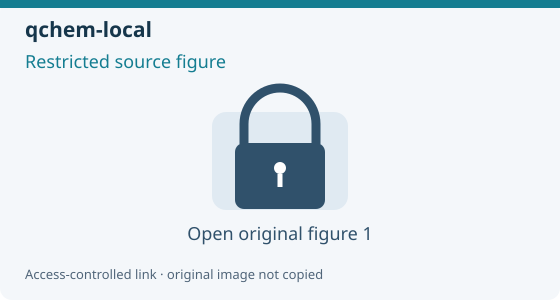</a> 元図 1（権限が必要）</td>
<td width="33%" align="center"> 元図 2（権限が必要）</td>
<td width="33%" align="center"> リポジトリ情報（概念図）</td>
</tr></table>

非公開の画像は公開側に複製していません。鍵付きカードは元ファイルへのリンクです。

## alexa-shopping-memo-skill-example

音声で入力した買い物項目をASK SDKからLINE Notifyへ渡すPython学習例。既存READMEに基づく概念図であり、現行サービスの動作を保証しない（LINE Notifyは終了済み）。

[Repository ↗](https://github.com/tr-o/alexa-shopping-memo-skill-example) · Updated: 2026-10-27 JST

<table><tr>
<td width="33%" align="center"> 音声入力から通知まで</td>
<td width="33%" align="center"><a href="assets/catalog/alexa-intents.svg">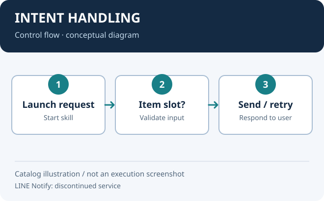</a> スキルの分岐</td>
<td width="33%" align="center"> システム構成</td>
</tr></table>

図：カタログ用に新規作成した概念図（実測・実行結果ではありません）。

## oxidation-descriptors

酸化特性記述子関連。詳細・成果はアクセス権のあるユーザーのみリンク先で確認できます。

[Repository ↗](https://github.com/tr-o/oxidation-descriptors) · private · Updated: 2026-10-26 JST

<table><tr>
<td width="33%" align="center"> 元図 1（権限が必要）</td>
<td width="33%" align="center"> 元図 2（権限が必要）</td>
<td width="33%" align="center"><a href="https://github.com/tr-o/oxidation-descriptors/blob/main/figures/fig11_final_model.png">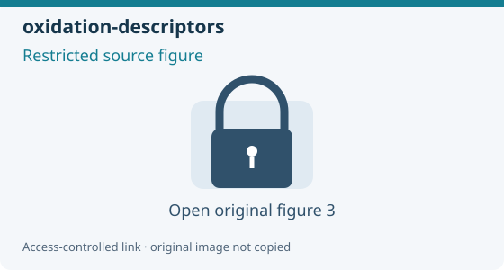</a> 元図 3（権限が必要）</td>
</tr></table>

非公開の画像は公開側に複製していません。鍵付きカードは元ファイルへのリンクです。

## medic

非公開プロジェクト。詳細・成果はアクセス権のあるユーザーのみリンク先で確認できます。

[Repository ↗](https://github.com/tr-o/medic) · private · Updated: 2026-10-26 JST

<table><tr>
<td width="33%" align="center"><a href="https://github.com/tr-o/medic">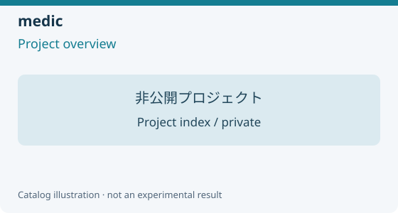</a> 概要図（概念図）</td>
<td width="33%" align="center"><a href="https://github.com/tr-o/medic">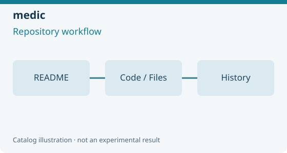</a> 構成イメージ（概念図）</td>
<td width="33%" align="center"><a href="https://github.com/tr-o/medic">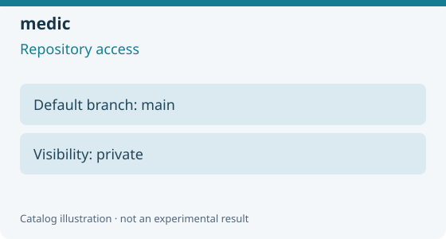</a> リポジトリ情報（概念図）</td>
</tr></table>

非公開の画像は公開側に複製していません。鍵付きカードは元ファイルへのリンクです。

## lir-fw-kinetics-report

反応速度解析関連。詳細・成果はアクセス権のあるユーザーのみリンク先で確認できます。

[Repository ↗](https://github.com/tr-o/lir-fw-kinetics-report) · private · Updated: 2026-10-22 JST

<table><tr>
<td width="33%" align="center"><a href="https://github.com/tr-o/lir-fw-kinetics-report/blob/main/figures/fig01_plasma_sampling_250Hz.png">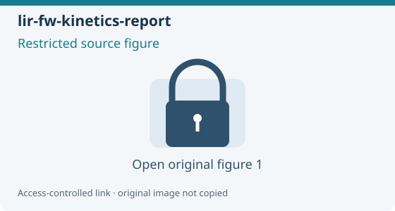</a> 元図 1（権限が必要）</td>
<td width="33%" align="center"> 元図 2（権限が必要）</td>
<td width="33%" align="center"><a href="https://github.com/tr-o/lir-fw-kinetics-report/blob/main/figures/fig03_firstorder_curves_highfreq.png">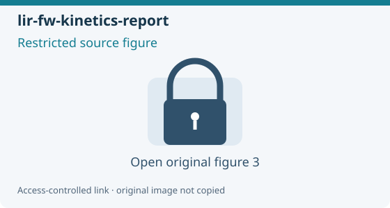</a> 元図 3（権限が必要）</td>
</tr></table>

非公開の画像は公開側に複製していません。鍵付きカードは元ファイルへのリンクです。

## sim-beam

レーザーシミュレーション関連。詳細・成果はアクセス権のあるユーザーのみリンク先で確認できます。

[Repository ↗](https://github.com/tr-o/sim-beam) · private · Updated: 2026-10-21 JST

<table><tr>
<td width="33%" align="center"> 元図 1（権限が必要）</td>
<td width="33%" align="center"> 元図 2（権限が必要）</td>
<td width="33%" align="center"> 元図 3（権限が必要）</td>
</tr></table>

非公開の画像は公開側に複製していません。鍵付きカードは元ファイルへのリンクです。

## piezo

圧電材料関連。詳細・成果はアクセス権のあるユーザーのみリンク先で確認できます。

[Repository ↗](https://github.com/tr-o/piezo) · private · Updated: 2026-10-20 JST

<table><tr>
<td width="33%" align="center"> 元図 1（権限が必要）</td>
<td width="33%" align="center"> 元図 2（権限が必要）</td>
<td width="33%" align="center"><a href="https://github.com/tr-o/piezo/blob/main/docs/figures/candidate_funnel.png">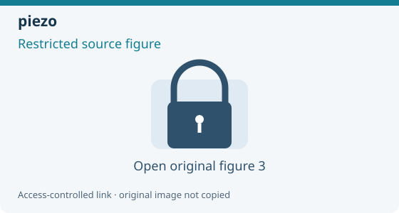</a> 元図 3（権限が必要）</td>
</tr></table>

非公開の画像は公開側に複製していません。鍵付きカードは元ファイルへのリンクです。

## public-data-warp

公開データ解析関連。詳細・成果はアクセス権のあるユーザーのみリンク先で確認できます。

[Repository ↗](https://github.com/tr-o/public-data-warp) · private · Updated: 2026-10-20 JST

<table><tr>
<td width="33%" align="center"><a href="https://github.com/tr-o/public-data-warp/blob/main/dos/research/02_jaggedness_check/figs/fig_roughness_comparison.png">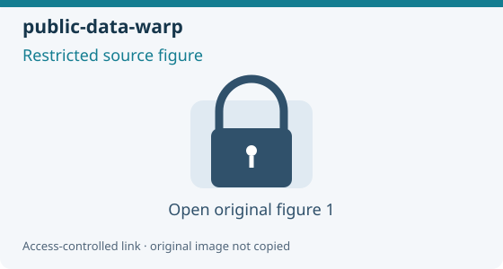</a> 元図 1（権限が必要）</td>
<td width="33%" align="center"><a href="https://github.com/tr-o/public-data-warp/blob/main/findings/01_mamun2019_cathub/mamun_vs_68_distribution.png">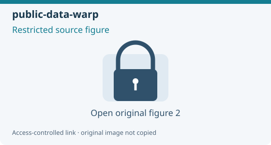</a> 元図 2（権限が必要）</td>
<td width="33%" align="center"> 元図 3（権限が必要）</td>
</tr></table>

非公開の画像は公開側に複製していません。鍵付きカードは元ファイルへのリンクです。

## harry-potter-shadowing

英語学習関連。詳細・成果はアクセス権のあるユーザーのみリンク先で確認できます。

[Repository ↗](https://github.com/tr-o/harry-potter-shadowing) · private · Updated: 2026-10-20 JST

<table><tr>
<td width="33%" align="center"><a href="https://github.com/tr-o/harry-potter-shadowing">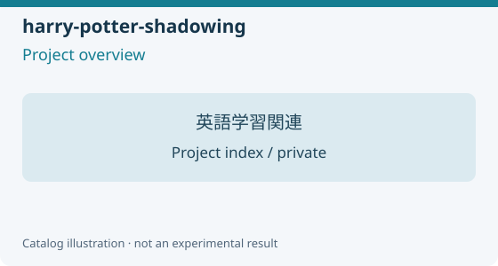</a> 概要図（概念図）</td>
<td width="33%" align="center"><a href="https://github.com/tr-o/harry-potter-shadowing">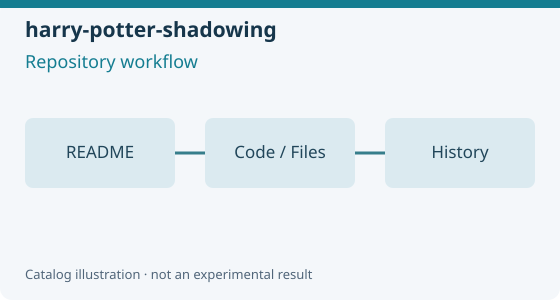</a> 構成イメージ（概念図）</td>
<td width="33%" align="center"><a href="https://github.com/tr-o/harry-potter-shadowing">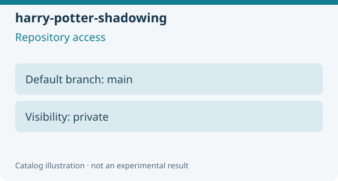</a> リポジトリ情報（概念図）</td>
</tr></table>

非公開の画像は公開側に複製していません。鍵付きカードは元ファイルへのリンクです。

## orca

量子化学計算関連。詳細・成果はアクセス権のあるユーザーのみリンク先で確認できます。

[Repository ↗](https://github.com/tr-o/orca) · private · Updated: 2026-10-07 JST

<table><tr>
<td width="33%" align="center"><a href="https://github.com/tr-o/orca">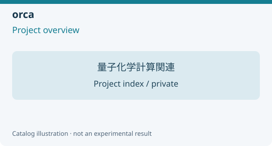</a> 概要図（概念図）</td>
<td width="33%" align="center"> 構成イメージ（概念図）</td>
<td width="33%" align="center"><a href="https://github.com/tr-o/orca">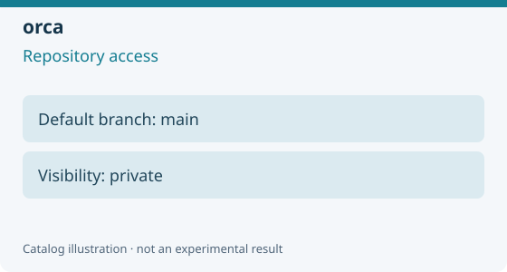</a> リポジトリ情報（概念図）</td>
</tr></table>

非公開の画像は公開側に複製していません。鍵付きカードは元ファイルへのリンクです。

## python-document-processor-for-mom

文書処理関連。詳細・成果はアクセス権のあるユーザーのみリンク先で確認できます。

[Repository ↗](https://github.com/tr-o/python-document-processor-for-mom) · private · Updated: 2026-09-21 JST

<table><tr>
<td width="33%" align="center"><a href="https://github.com/tr-o/python-document-processor-for-mom">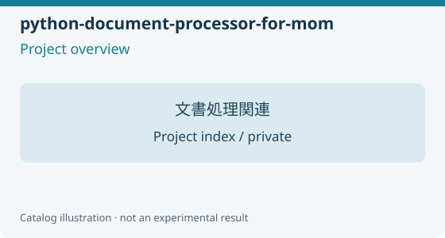</a> 概要図（概念図）</td>
<td width="33%" align="center"><a href="https://github.com/tr-o/python-document-processor-for-mom">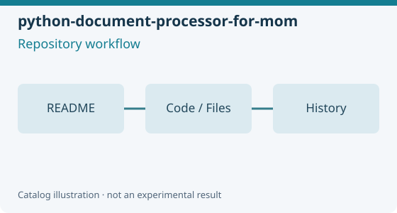</a> 構成イメージ（概念図）</td>
<td width="33%" align="center"><a href="https://github.com/tr-o/python-document-processor-for-mom">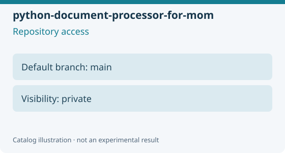</a> リポジトリ情報（概念図）</td>
</tr></table>

非公開の画像は公開側に複製していません。鍵付きカードは元ファイルへのリンクです。

## meltingpoint-prediction

融点予測関連。詳細・成果はアクセス権のあるユーザーのみリンク先で確認できます。

[Repository ↗](https://github.com/tr-o/meltingpoint-prediction) · private · Updated: 2026-09-14 JST

<table><tr>
<td width="33%" align="center"> 概要図（概念図）</td>
<td width="33%" align="center"> 構成イメージ（概念図）</td>
<td width="33%" align="center"> リポジトリ情報（概念図）</td>
</tr></table>

非公開の画像は公開側に複製していません。鍵付きカードは元ファイルへのリンクです。

## cpa2021v02

非公開プロジェクト。詳細・成果はアクセス権のあるユーザーのみリンク先で確認できます。

[Repository ↗](https://github.com/tr-o/cpa2021v02) · private · Updated: 2026-04-06 JST

<table><tr>
<td width="33%" align="center"><a href="https://github.com/tr-o/cpa2021v02">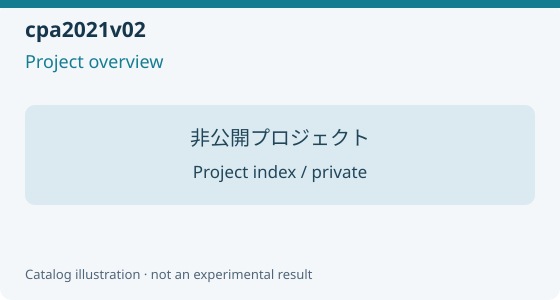</a> 概要図（概念図）</td>
<td width="33%" align="center"><a href="https://github.com/tr-o/cpa2021v02">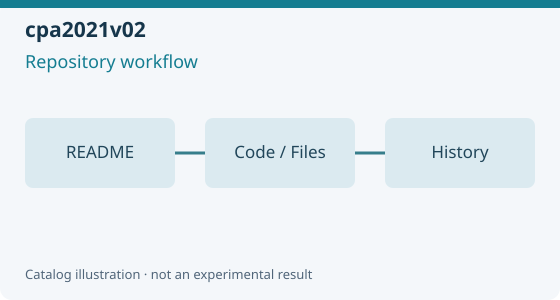</a> 構成イメージ（概念図）</td>
<td width="33%" align="center"> リポジトリ情報（概念図）</td>
</tr></table>

非公開の画像は公開側に複製していません。鍵付きカードは元ファイルへのリンクです。

## GAS-Dynamic-Data-Visualizer

Google Apps Scriptによる動的データ可視化。

[Repository ↗](https://github.com/tr-o/GAS-Dynamic-Data-Visualizer) · public · Updated: 2026-03-29 JST

<table><tr>
<td width="33%" align="center"><a href="https://github.com/tr-o/GAS-Dynamic-Data-Visualizer">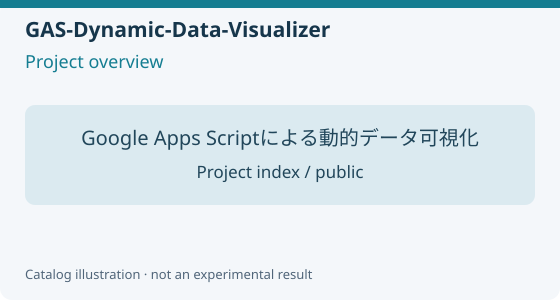</a> 概要図（概念図）</td>
<td width="33%" align="center"><a href="https://github.com/tr-o/GAS-Dynamic-Data-Visualizer">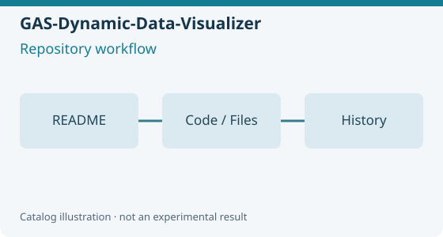</a> 構成イメージ（概念図）</td>
<td width="33%" align="center"><a href="https://github.com/tr-o/GAS-Dynamic-Data-Visualizer">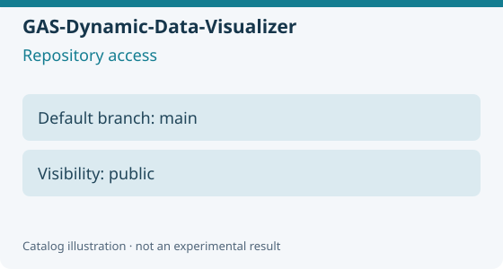</a> リポジトリ情報（概念図）</td>
</tr></table>

概念図はカタログ用の模式図であり、計算結果・実測値ではありません。

## google-sheets-data-visualization

Google Sheetsのデータ可視化。

[Repository ↗](https://github.com/tr-o/google-sheets-data-visualization) · public · Updated: 2026-03-29 JST

<table><tr>
<td width="33%" align="center"><a href="https://github.com/tr-o/google-sheets-data-visualization">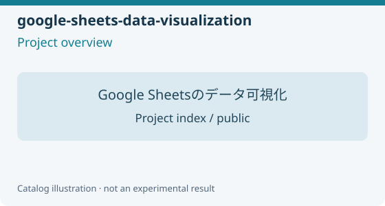</a> 概要図（概念図）</td>
<td width="33%" align="center"><a href="https://github.com/tr-o/google-sheets-data-visualization">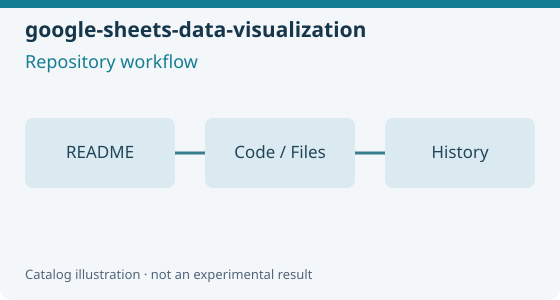</a> 構成イメージ（概念図）</td>
<td width="33%" align="center"><a href="https://github.com/tr-o/google-sheets-data-visualization">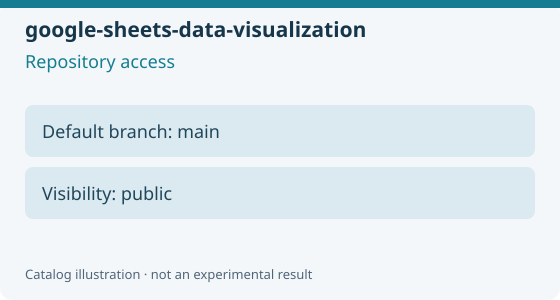</a> リポジトリ情報（概念図）</td>
</tr></table>

概念図はカタログ用の模式図であり、計算結果・実測値ではありません。

## SwitchBot-Data-Logger-for-Google-Sheets

SwitchBotデータのGoogle Sheets記録。

[Repository ↗](https://github.com/tr-o/SwitchBot-Data-Logger-for-Google-Sheets) · public · Updated: 2026-02-06 JST

<table><tr>
<td width="33%" align="center"><a href="https://github.com/tr-o/SwitchBot-Data-Logger-for-Google-Sheets">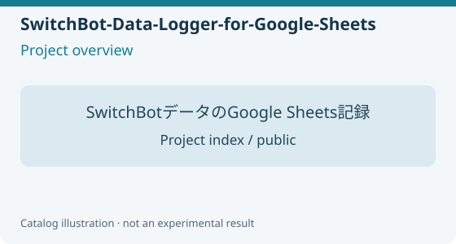</a> 概要図（概念図）</td>
<td width="33%" align="center"><a href="https://github.com/tr-o/SwitchBot-Data-Logger-for-Google-Sheets">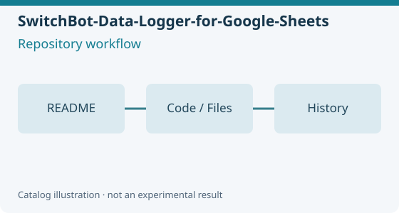</a> 構成イメージ（概念図）</td>
<td width="33%" align="center"><a href="https://github.com/tr-o/SwitchBot-Data-Logger-for-Google-Sheets">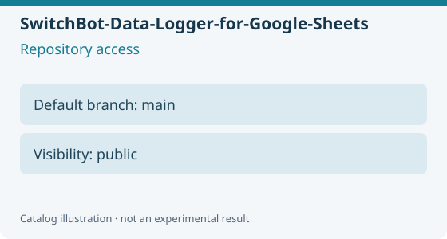</a> リポジトリ情報（概念図）</td>
</tr></table>

概念図はカタログ用の模式図であり、計算結果・実測値ではありません。

## tes-repo

テスト用リポジトリ。詳細・成果はアクセス権のあるユーザーのみリンク先で確認できます。

[Repository ↗](https://github.com/tr-o/tes-repo) · private · Updated: 2026-01-06 JST

<table><tr>
<td width="33%" align="center"><a href="https://github.com/tr-o/tes-repo">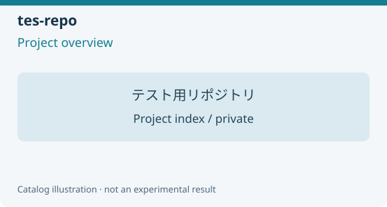</a> 概要図（概念図）</td>
<td width="33%" align="center"><a href="https://github.com/tr-o/tes-repo">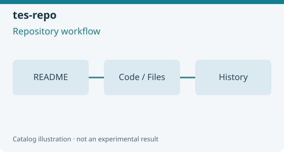</a> 構成イメージ（概念図）</td>
<td width="33%" align="center"><a href="https://github.com/tr-o/tes-repo">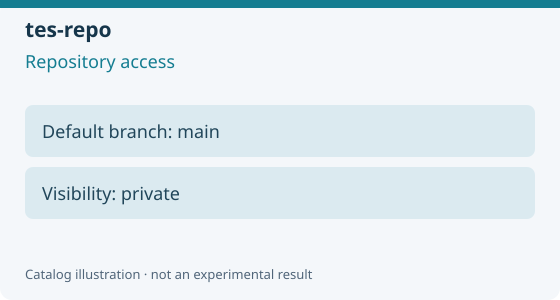</a> リポジトリ情報（概念図）</td>
</tr></table>

非公開の画像は公開側に複製していません。鍵付きカードは元ファイルへのリンクです。

## coten

非公開プロジェクト。詳細・成果はアクセス権のあるユーザーのみリンク先で確認できます。

[Repository ↗](https://github.com/tr-o/coten) · private · Updated: 2025-12-11 JST

<table><tr>
<td width="33%" align="center"><a href="https://github.com/tr-o/coten/blob/main/image.png">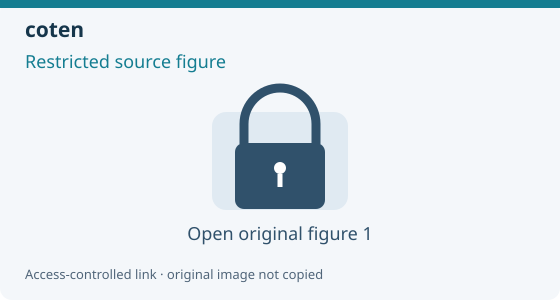</a> 元図 1（権限が必要）</td>
<td width="33%" align="center"><a href="https://github.com/tr-o/coten">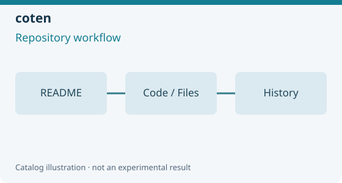</a> 構成イメージ（概念図）</td>
<td width="33%" align="center"> リポジトリ情報（概念図）</td>
</tr></table>

非公開の画像は公開側に複製していません。鍵付きカードは元ファイルへのリンクです。

## mic-fft

マイク入力とFFT。詳細・成果はアクセス権のあるユーザーのみリンク先で確認できます。

[Repository ↗](https://github.com/tr-o/mic-fft) · private · Updated: 2025-12-11 JST

<table><tr>
<td width="33%" align="center"> 元図 1（権限が必要）</td>
<td width="33%" align="center"> 元図 2（権限が必要）</td>
<td width="33%" align="center"> 元図 3（権限が必要）</td>
</tr></table>

非公開の画像は公開側に複製していません。鍵付きカードは元ファイルへのリンクです。

## experiment-django

Djangoによる実験関連開発。詳細・成果はアクセス権のあるユーザーのみリンク先で確認できます。

[Repository ↗](https://github.com/tr-o/experiment-django) · private · Updated: 2025-11-27 JST

<table><tr>
<td width="33%" align="center"><a href="https://github.com/tr-o/experiment-django">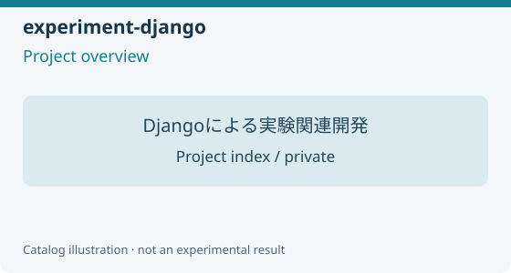</a> 概要図（概念図）</td>
<td width="33%" align="center"><a href="https://github.com/tr-o/experiment-django">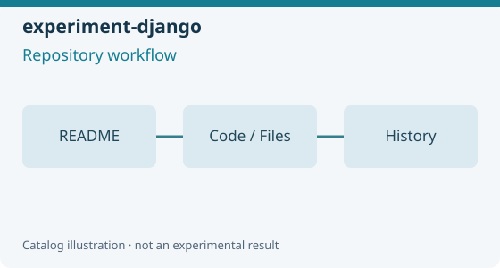</a> 構成イメージ（概念図）</td>
<td width="33%" align="center"><a href="https://github.com/tr-o/experiment-django">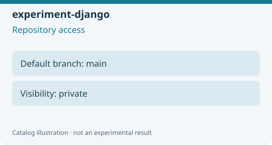</a> リポジトリ情報（概念図）</td>
</tr></table>

非公開の画像は公開側に複製していません。鍵付きカードは元ファイルへのリンクです。

## django-demo

Djangoのデモ。詳細・成果はアクセス権のあるユーザーのみリンク先で確認できます。

[Repository ↗](https://github.com/tr-o/django-demo) · private · Updated: 2025-11-22 JST

<table><tr>
<td width="33%" align="center"><a href="https://github.com/tr-o/django-demo">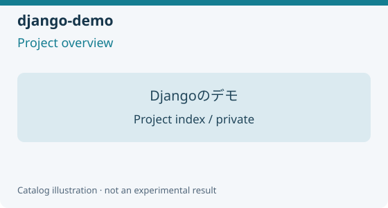</a> 概要図（概念図）</td>
<td width="33%" align="center"><a href="https://github.com/tr-o/django-demo">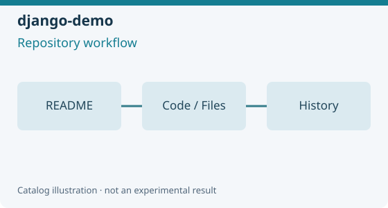</a> 構成イメージ（概念図）</td>
<td width="33%" align="center"> リポジトリ情報（概念図）</td>
</tr></table>

非公開の画像は公開側に複製していません。鍵付きカードは元ファイルへのリンクです。

## experiment-master

実験管理関連。詳細・成果はアクセス権のあるユーザーのみリンク先で確認できます。

[Repository ↗](https://github.com/tr-o/experiment-master) · private · Updated: 2025-11-20 JST

<table><tr>
<td width="33%" align="center"><a href="https://github.com/tr-o/experiment-master">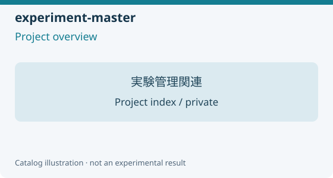</a> 概要図（概念図）</td>
<td width="33%" align="center"><a href="https://github.com/tr-o/experiment-master">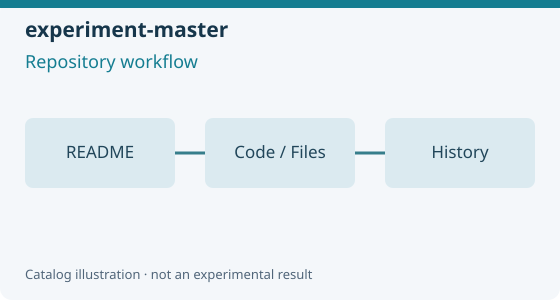</a> 構成イメージ（概念図）</td>
<td width="33%" align="center"><a href="https://github.com/tr-o/experiment-master">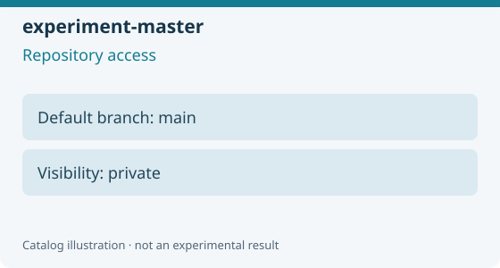</a> リポジトリ情報（概念図）</td>
</tr></table>

非公開の画像は公開側に複製していません。鍵付きカードは元ファイルへのリンクです。

## mixtracer_c

C言語関連プロジェクト。詳細・成果はアクセス権のあるユーザーのみリンク先で確認できます。

[Repository ↗](https://github.com/tr-o/mixtracer_c) · private · Updated: 2025-11-17 JST

<table><tr>
<td width="33%" align="center"><a href="https://github.com/tr-o/mixtracer_c">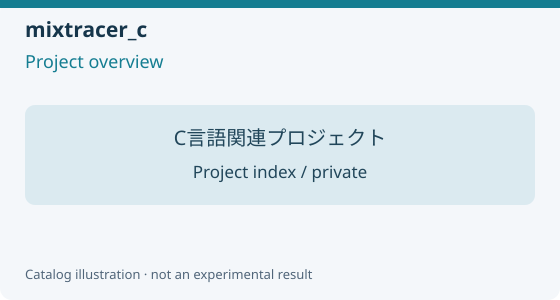</a> 概要図（概念図）</td>
<td width="33%" align="center"><a href="https://github.com/tr-o/mixtracer_c">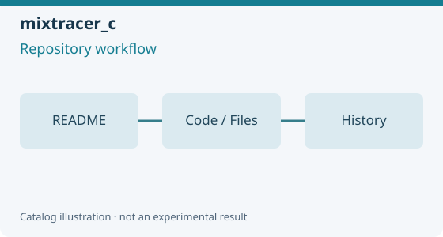</a> 構成イメージ（概念図）</td>
<td width="33%" align="center"><a href="https://github.com/tr-o/mixtracer_c">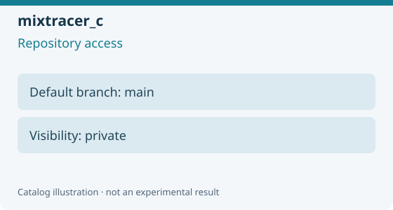</a> リポジトリ情報（概念図）</td>
</tr></table>

非公開の画像は公開側に複製していません。鍵付きカードは元ファイルへのリンクです。

## gomi-notify-discord

Discord通知関連。詳細・成果はアクセス権のあるユーザーのみリンク先で確認できます。

[Repository ↗](https://github.com/tr-o/gomi-notify-discord) · private · Updated: 2025-11-16 JST

<table><tr>
<td width="33%" align="center"><a href="https://github.com/tr-o/gomi-notify-discord">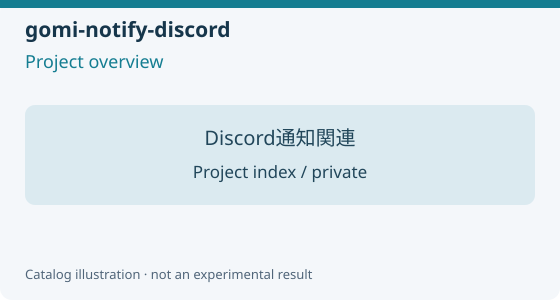</a> 概要図（概念図）</td>
<td width="33%" align="center"><a href="https://github.com/tr-o/gomi-notify-discord">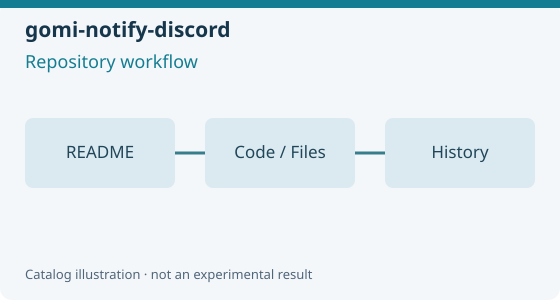</a> 構成イメージ（概念図）</td>
<td width="33%" align="center"> リポジトリ情報（概念図）</td>
</tr></table>

非公開の画像は公開側に複製していません。鍵付きカードは元ファイルへのリンクです。

## train-passing-timetable

鉄道時刻表関連。詳細・成果はアクセス権のあるユーザーのみリンク先で確認できます。

[Repository ↗](https://github.com/tr-o/train-passing-timetable) · private · Updated: 2025-11-03 JST

<table><tr>
<td width="33%" align="center"> 概要図（概念図）</td>
<td width="33%" align="center"> 構成イメージ（概念図）</td>
<td width="33%" align="center"> リポジトリ情報（概念図）</td>
</tr></table>

非公開の画像は公開側に複製していません。鍵付きカードは元ファイルへのリンクです。

## photoserver

写真サーバー。詳細・成果はアクセス権のあるユーザーのみリンク先で確認できます。

[Repository ↗](https://github.com/tr-o/photoserver) · private · Updated: 2025-09-28 JST

<table><tr>
<td width="33%" align="center"> 概要図（概念図）</td>
<td width="33%" align="center"> 構成イメージ（概念図）</td>
<td width="33%" align="center"> リポジトリ情報（概念図）</td>
</tr></table>

非公開の画像は公開側に複製していません。鍵付きカードは元ファイルへのリンクです。

## speech-fluency-coach

発話練習関連。詳細・成果はアクセス権のあるユーザーのみリンク先で確認できます。

[Repository ↗](https://github.com/tr-o/speech-fluency-coach) · private · Updated: 2025-07-20 JST

<table><tr>
<td width="33%" align="center"> 概要図（概念図）</td>
<td width="33%" align="center"> 構成イメージ（概念図）</td>
<td width="33%" align="center"> リポジトリ情報（概念図）</td>
</tr></table>

非公開の画像は公開側に複製していません。鍵付きカードは元ファイルへのリンクです。

## train-go-through

鉄道関連プロジェクト。

[Repository ↗](https://github.com/tr-o/train-go-through) · public · Updated: 2025-06-01 JST

<table><tr>
<td width="33%" align="center"> 概要図（概念図）</td>
<td width="33%" align="center"> 構成イメージ（概念図）</td>
<td width="33%" align="center"> リポジトリ情報（概念図）</td>
</tr></table>

概念図はカタログ用の模式図であり、計算結果・実測値ではありません。

## SwitchBot-ESP32-GoogleSheet-Logger

ESP32とSwitchBotによるデータ記録。

[Repository ↗](https://github.com/tr-o/SwitchBot-ESP32-GoogleSheet-Logger) · public · Updated: 2025-03-13 JST

<table><tr>
<td width="33%" align="center"> 概要図（概念図）</td>
<td width="33%" align="center"> 構成イメージ（概念図）</td>
<td width="33%" align="center"> リポジトリ情報（概念図）</td>
</tr></table>

概念図はカタログ用の模式図であり、計算結果・実測値ではありません。

## Python-SwitchBot-API-Example

PythonによるSwitchBot APIの利用例。

[Repository ↗](https://github.com/tr-o/Python-SwitchBot-API-Example) · public · Updated: 2024-02-23 JST

<table><tr>
<td width="33%" align="center"> 概要図（概念図）</td>
<td width="33%" align="center"> 構成イメージ（概念図）</td>
<td width="33%" align="center"> リポジトリ情報（概念図）</td>
</tr></table>

概念図はカタログ用の模式図であり、計算結果・実測値ではありません。

## python-image-process-exercise

Python画像処理の演習。

[Repository ↗](https://github.com/tr-o/python-image-process-exercise) · public · Updated: 2023-07-08 JST

<table><tr>
<td width="33%" align="center"> image.png</td>
<td width="33%" align="center"> 構成イメージ（概念図）</td>
<td width="33%" align="center"> リポジトリ情報（概念図）</td>
</tr></table>

概念図はカタログ用の模式図であり、計算結果・実測値ではありません。

## image-process-exercise

画像処理の演習。詳細・成果はアクセス権のあるユーザーのみリンク先で確認できます。

[Repository ↗](https://github.com/tr-o/image-process-exercise) · private · Updated: 2023-05-11 JST

<table><tr>
<td width="33%" align="center"> 概要図（概念図）</td>
<td width="33%" align="center"> 構成イメージ（概念図）</td>
<td width="33%" align="center"> リポジトリ情報（概念図）</td>
</tr></table>

非公開の画像は公開側に複製していません。鍵付きカードは元ファイルへのリンクです。

## Mermaid-syntax-for-chemical-process

化学プロセス図のMermaid記法。詳細・成果はアクセス権のあるユーザーのみリンク先で確認できます。

[Repository ↗](https://github.com/tr-o/Mermaid-syntax-for-chemical-process) · private · Updated: 2023-05-05 JST

<table><tr>
<td width="33%" align="center"> 概要図（概念図）</td>
<td width="33%" align="center"> 構成イメージ（概念図）</td>
<td width="33%" align="center"> リポジトリ情報（概念図）</td>
</tr></table>

非公開の画像は公開側に複製していません。鍵付きカードは元ファイルへのリンクです。

## Mermaid-syntax-for-chemicaal-process

化学プロセス図の記法（別リポジトリ）。詳細・成果はアクセス権のあるユーザーのみリンク先で確認できます。

[Repository ↗](https://github.com/tr-o/Mermaid-syntax-for-chemicaal-process) · private · Updated: 2023-05-05 JST

<table><tr>
<td width="33%" align="center"> 概要図（概念図）</td>
<td width="33%" align="center"> 構成イメージ（概念図）</td>
<td width="33%" align="center"> リポジトリ情報（概念図）</td>
</tr></table>

非公開の画像は公開側に複製していません。鍵付きカードは元ファイルへのリンクです。

## Summar-of-aluminum-production

アルミニウム製造の整理。詳細・成果はアクセス権のあるユーザーのみリンク先で確認できます。

[Repository ↗](https://github.com/tr-o/Summar-of-aluminum-production) · private · Updated: 2023-05-05 JST

<table><tr>
<td width="33%" align="center"> 概要図（概念図）</td>
<td width="33%" align="center"> 構成イメージ（概念図）</td>
<td width="33%" align="center"> リポジトリ情報（概念図）</td>
</tr></table>

非公開の画像は公開側に複製していません。鍵付きカードは元ファイルへのリンクです。

## Tempo-control-Arduino-MIDI-Drum-Sequencer

Arduino MIDIドラムシーケンサー。

[Repository ↗](https://github.com/tr-o/Tempo-control-Arduino-MIDI-Drum-Sequencer) · public · Updated: 2023-05-04 JST

<table><tr>
<td width="33%" align="center"> 概要図（概念図）</td>
<td width="33%" align="center"> 構成イメージ（概念図）</td>
<td width="33%" align="center"> リポジトリ情報（概念図）</td>
</tr></table>

概念図はカタログ用の模式図であり、計算結果・実測値ではありません。

## LINE-spreadsheeet-aidedGarbageReminder

スプレッドシートを利用したゴミ出し通知。

[Repository ↗](https://github.com/tr-o/LINE-spreadsheeet-aidedGarbageReminder) · public · Updated: 2023-05-01 JST

<table><tr>
<td width="33%" align="center"> 概要図（概念図）</td>
<td width="33%" align="center"> 構成イメージ（概念図）</td>
<td width="33%" align="center"> リポジトリ情報（概念図）</td>
</tr></table>

概念図はカタログ用の模式図であり、計算結果・実測値ではありません。

## test

テスト用リポジトリ。

[Repository ↗](https://github.com/tr-o/test) · public · Updated: 2022-01-23 JST

<table><tr>
<td width="33%" align="center"> 概要図（概念図）</td>
<td width="33%" align="center"> 構成イメージ（概念図）</td>
<td width="33%" align="center"> リポジトリ情報（概念図）</td>
</tr></table>

概念図はカタログ用の模式図であり、計算結果・実測値ではありません。

## tr-o

全リポジトリのビジュアルカタログ。

[Repository ↗](https://github.com/tr-o/tr-o) · public · Updated: 2022-01-23 JST

<table><tr>
<td width="33%" align="center"> 概要図（概念図）</td>
<td width="33%" align="center"> 構成イメージ（概念図）</td>
<td width="33%" align="center"> リポジトリ情報（概念図）</td>
</tr></table>

概念図はカタログ用の模式図であり、計算結果・実測値ではありません。
