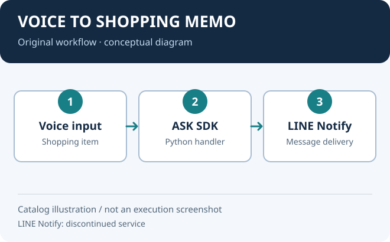
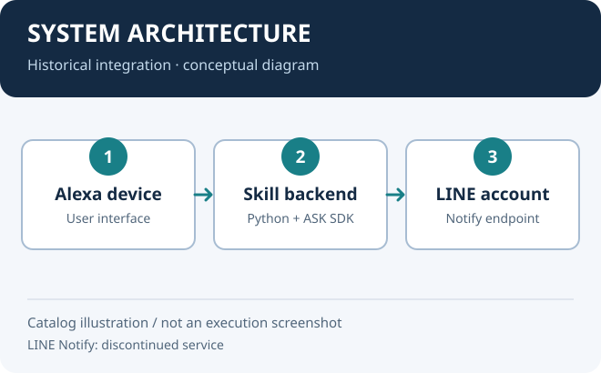

# Projects / Visual Catalog

研究・開発プロジェクトを、成果図とともに紹介します。

**公開版 · 2026-11-27** / 更新日時は GitHub API `updated_at`（JSTの日付）。指定された基準日時より新しい公開プロジェクトのみ掲載。非公開リポジトリの名称・成果図・研究内容はこの公開ページに含めません。

| Project | Updated (JST) | Focus |
|---|---|---|
| [dlvo](#dlvo) | 2026-11-15 | コロイド粒子間のファンデルワールス引力・電気二重層反発を計算 |
| [tem-nanoparticle-analyzer](#tem-nanoparticle-analyzer) | 2026-10-30 | TEM・HRTEMの粒径計測、粒子分離、スケール校正、監査と教師ありモデルの検証 |
| [alexa-shopping-memo-skill-example](#alexa-shopping-memo-skill-example) | 2026-10-27 | 音声で入力した買い物項目をASK SDKからLINE Notifyへ渡すPython学習例 |

## dlvo

コロイド粒子間のファンデルワールス引力・電気二重層反発を計算。非線形PB、球曲率、電荷調節、吸着層の条件探索。

[Repository ↗](https://github.com/tr-o/dlvo) · Updated: 2026-11-15 JST

<table><tr>
<td width="33%" align="center"> DLVO相互作用</td>
<td width="33%" align="center"> 10 nm粒子の電位分布</td>
<td width="33%" align="center"> 安定化に必要な吸着層反発</td>
</tr></table>

図：元リポジトリの保存済み成果（コミット固定リンク）。

## tem-nanoparticle-analyzer

TEM・HRTEMの粒径計測、粒子分離、スケール校正、監査と教師ありモデルの検証。研究プロトタイプ。

[Repository ↗](https://github.com/tr-o/tem-nanoparticle-analyzer) · Updated: 2026-10-30 JST

<table><tr>
<td width="33%" align="center"> Pt/Ag 6視野の検出監査</td>
<td width="33%" align="center"> DM3/HRTEM解析と粒径分布</td>
<td width="33%" align="center"> 学習データ増量とF1の不確実性</td>
</tr></table>

図：元リポジトリの保存済み成果（コミット固定リンク）。

## alexa-shopping-memo-skill-example

音声で入力した買い物項目をASK SDKからLINE Notifyへ渡すPython学習例。既存READMEに基づく概念図であり、現行サービスの動作を保証しない（LINE Notifyは終了済み）。

[Repository ↗](https://github.com/tr-o/alexa-shopping-memo-skill-example) · Updated: 2026-10-27 JST

<table><tr>
<td width="33%" align="center"> 音声入力から通知まで</td>
<td width="33%" align="center"> スキルの分岐</td>
<td width="33%" align="center"> システム構成</td>
</tr></table>

図：カタログ用に新規作成した概念図（実測・実行結果ではありません）。

